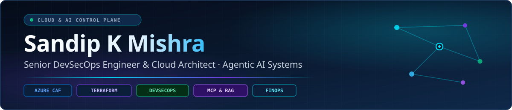
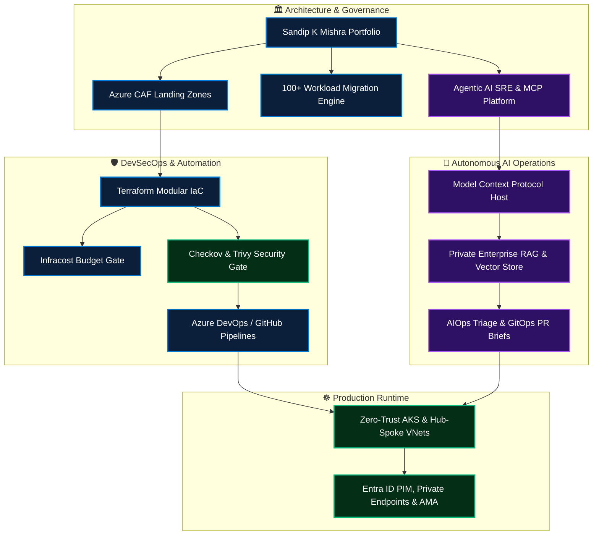

### 🔐 Senior DevSecOps Engineer & Cloud Architect | Agentic AI Systems

**Enterprise Cloud Infrastructure · Zero-Trust Security · GitOps Automation · Autonomous SRE**

---

## 👋 About Me

I am **Sandip K Mishra**, a **Senior DevSecOps Engineer & Cloud Solutions Architect** specializing in production-grade Microsoft Azure infrastructure, multi-cloud landing zones, shift-left pipeline security, and **Agentic AI systems (Model Context Protocol, Private RAG, and autonomous SRE operations)**.

My architectural background focuses on **governing and migrating 100+ mission-critical workloads** to the cloud with low/zero downtime, enforcing zero-trust Infrastructure as Code (Terraform), aligning technology with business ROI, and leading vendor governance (RFI/RFP, SOW, RACI) and engineering teams.

* ☁️ **Cloud & Scale:** Designing enterprise Hub-and-Spoke topologies, Azure Cloud Adoption Framework (CAF) landing zones, and Kubernetes platforms (AKS/EKS).
* 🛡️ **DevSecOps & Supply Chain:** Baking automated security gates (Checkov, Trivy, `tfsec`, GitLeaks, OPA) into Azure DevOps and GitHub Actions CI/CD pipelines.
* 🤖 **Agentic AI & LLMOps:** Implementing **Model Context Protocol (MCP)** tool gateways and **Private Enterprise RAG** for automated incident triage, runbook intelligence, and PR blast-radius analysis.
* 💰 **FinOps & Governance:** Driving cloud cost efficiency through VM rightsizing, Reserved Instances/Savings Plans, DCR log ingestion tuning, orphan resource cleanup, and Infracost PR gates.

---

## 🧭 Portfolio Delivery Map

---

## 🧰 Technology Stack

 

| Domain | Skills, Frameworks & Enterprise Tooling |
|---|---|
| ☁️ **Cloud & Architecture** | Microsoft Azure, AWS, Hub-and-Spoke VNets, ExpressRoute, Azure Firewall Premium, Private Endpoints, Azure Landing Zones (CAF), Azure Site Recovery (ASR) |
| 🏗️ **Infrastructure as Code** | Terraform, modular IaC design, Azure Blob Storage remote state lease-locking, Managed Identities, semantic versioning, nightly drift detection |
| 🔄 **CI/CD & Automation** | GitHub Actions, Azure DevOps Pipelines, trunk-based development, `CODEOWNERS`, dual-senior PR gates, ArgoCD, automated rollback |
| 🔐 **DevSecOps & Supply Chain** | Shift-Left security, Checkov (CIS/MCSB Benchmarks), `tfsec`, Trivy, GitLeaks, `tflint`, Entra ID, PIM JIT, Customer-Managed Keys (CMK) |
| 🤖 **Agentic AI & LLMOps** | Model Context Protocol (MCP), Private Enterprise RAG, Azure OpenAI VNet isolation, Vector Databases, AI Gateway token FinOps, AIOps |
| 📦 **Containers & Platforms** | Kubernetes (AKS/EKS), Docker, Helm, multi-AZ VM Scale Sets (VMSS), Cloud-Init bootstrapping |
| 📊 **Observability & SRE** | Azure Monitor, Azure Monitor Agent (AMA), Data Collection Rules (DCR), Log Analytics, Prometheus, Grafana, PagerDuty/Teams/Slack alerting, RTO/RPO |
| 💰 **FinOps & Governance** | Infracost pre-merge budget gates, Azure Policy Initiatives, 30-day rightsizing, Reserved Instances (RI), Savings Plans, RFI/RFP/SOW/RACI governance |

---

## 🚀 Featured Architecture & Engineering Blueprints

> The blueprints below are documented in full inside this repository's [**Enterprise Cloud, DevSecOps & AI Architecture Guide**](docs/architecture-and-delivery-guide.md).

### 1. 🔐 Enterprise Cloud Landing Zones & Hub-and-Spoke Security
Production-grade Terraform and Microsoft Cloud Adoption Framework (CAF) architecture featuring Management Group isolation (`Platform` vs. `Landing Zones`), Privileged Identity Management (PIM), and Azure Policy guardrails.
* **Architecture:** Segmented `Dev`/`UAT`/`Prod` subscriptions, User Defined Routes (UDRs) forcing `0.0.0.0/0` egress through Azure Firewall Premium with TLS inspection, Private Endpoints, and central Private DNS Zones.
* **Security & Governance:** Enforces CIS Microsoft Azure Benchmark and MCSB compliance with automated Checkov, `tfsec`, and Trivy gates.

[**View CAF & Hub-and-Spoke Blueprint →**](docs/architecture-and-delivery-guide.md#5-enterprise-governance-identity--management-hierarchy-caf) · [**Networking Topology →**](docs/architecture-and-delivery-guide.md#6-enterprise-hub-and-spoke-networking-architecture) · [**Defense-in-Depth Matrix →**](docs/architecture-and-delivery-guide.md#7-multi-layered-defense-in-depth-security)

---

### 2. 🤖 Private Enterprise AI Platform (MCP, RAG & AIOps)
Zero-trust reference architecture for enterprise **Retrieval-Augmented Generation (RAG)** and **Model Context Protocol (MCP)** gateways engineered for regulated enterprise environments.
* **Private AI & Autonomous Operations:** VNet-isolated RAG pipelines and Vector Stores behind Private Endpoints, paired with least-privilege MCP servers exposing runbooks, Git metadata, and observability telemetry for rapid incident triage and PR blast-radius summaries.
* **AI FinOps & Guardrails:** Entra ID authentication, AI Gateway rate-limiting, token cost tracking, and deterministic policy gates as final merge authority.

[**View Private AI, MCP & AIOps Blueprint →**](docs/architecture-and-delivery-guide.md#15-enterprise-ai-platform-engineering-private-rag-mcp--aiops)

---

### 3. 🚀 100+ Application Cloud Migration Factory
End-to-end on-premises-to-Azure migration framework built around 10 production quality pillars (*Scalable, Robust, Secure, Reliable, Portable, Governed, Highly Available, Cost-Optimized, Backed Up, Compliant & Monitored*).
* **Execution Engine:** Five-phase delivery across Discovery (Azure Migrate & dependency mapping), Compatibility & TCO/ROI Assessment, Landing Zone Readiness, low-downtime Cutover (DNS TTL tuning & DB replication sync), and 2–4 weeks dedicated war-room Hypercare.
* **Resilience & DR:** Multi-AZ VMSS, LRS/ZRS/GRS storage tiers, Azure Site Recovery (ASR) to paired regions, and strict RTO/RPO SLAs.

[**View Migration Strategy →**](docs/architecture-and-delivery-guide.md#10-end-to-end-cloud-migration-execution-strategy) · [**10 Quality Pillars →**](docs/architecture-and-delivery-guide.md#4-100-application-migration-scenario--10-quality-pillars) · [**Backup & DR →**](docs/architecture-and-delivery-guide.md#12-backup-disaster-recovery--high-availability)

---

### 4. 💰 Automated Terraform DevSecOps, FinOps & Vendor Governance
Trunk-based IaC delivery pipeline combined with cloud financial operations (FinOps) and executive delivery governance.
* **Pipeline & FinOps:** Automated `terraform fmt`, `tflint`, GitLeaks, Checkov, Trivy, Infracost PR cost gating, Blob-locked remote state, nightly `terraform plan -detailed-exitcode` drift detection, 30-day rightsizing, RIs/Savings Plans, and AMA DCR log filtering.
* **Executive Delivery:** RFI/RFP technical proposals, POCs, SOW deliverable acceptance criteria, Technical Evaluation Matrices, RACI/Escalation Matrices, and structured team KT.

[**View Terraform Automation →**](docs/architecture-and-delivery-guide.md#8-terraform-landing-zone-automation--drift-governance) · [**FinOps Playbook →**](docs/architecture-and-delivery-guide.md#11-finops-cloud-financial-management) · [**Vendor & Pre-Sales Governance →**](docs/architecture-and-delivery-guide.md#14-vendor-management-pre-sales--delivery-governance)

---

## 🔒 How I Approach DevSecOps

- **Shift-Left Security:** Embed security checks directly into developer workflows (`terraform fmt`, `tflint`, GitLeaks, Checkov, `tfsec`, and Trivy).
- **Zero-Trust Identity:** Eliminate permanent elevated privileges using Microsoft Entra ID Privileged Identity Management (PIM) with Just-In-Time access and Managed Identities.
- **Immutable Infrastructure as Code:** Enforce version-controlled, modular Terraform with remote state lease locking in Azure Blob Storage and nightly drift detection.
- **Predictive FinOps Gates:** Integrate Infracost directly into pull requests and tune AMA Data Collection Rules (DCR) to make cloud spend transparent and accountable.
- **AI-Augmented & Self-Healing Operations:** Pair **Model Context Protocol (MCP)** and **Private RAG** assistants with deterministic CI/CD gates so teams triage faster without sacrificing auditability.

---

## 🎯 Current Focus

- Expanding **Model Context Protocol (MCP)** server integrations and **Private Enterprise RAG** patterns for secure cloud telemetry and SRE triage.
- Scaling reusable **Azure CAF Landing Zone** Terraform modules with automated CIS/MCSB policy compliance and drift remediation.
- Designing multi-region disaster recovery frameworks with **Azure Site Recovery (ASR)**, multi-AZ VMSS, and verified RTO/RPO runbooks.
- Optimizing enterprise **Azure Monitor Agent (AMA)** Data Collection Rules (DCR) and FinOps automation across non-production and production estates.

---

## 📈 Engineering Telemetry

---

## 🤝 Connect

I welcome conversations regarding Cloud Architecture, Enterprise DevSecOps transformations, 100+ workload migrations, Kubernetes platforms, FinOps, and Private AI / MCP infrastructure.

 

