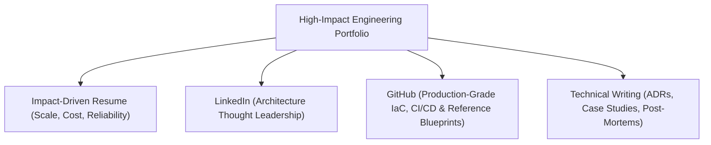
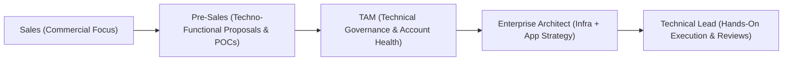
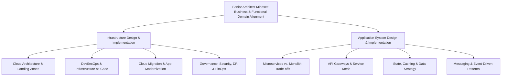
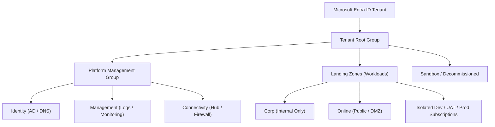
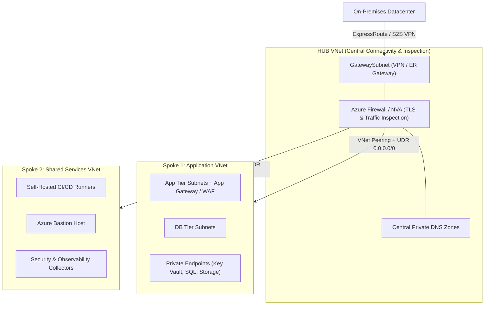
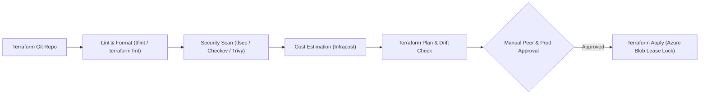
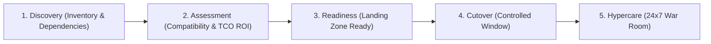
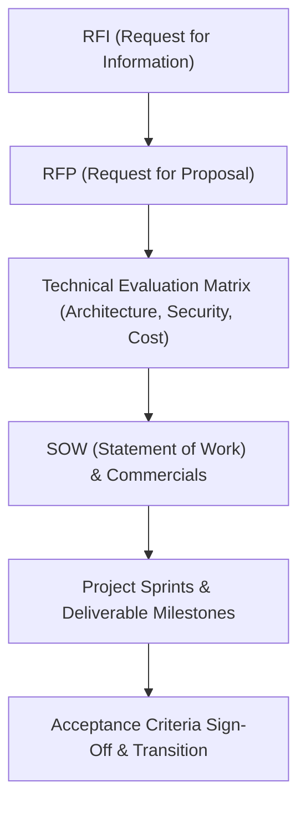
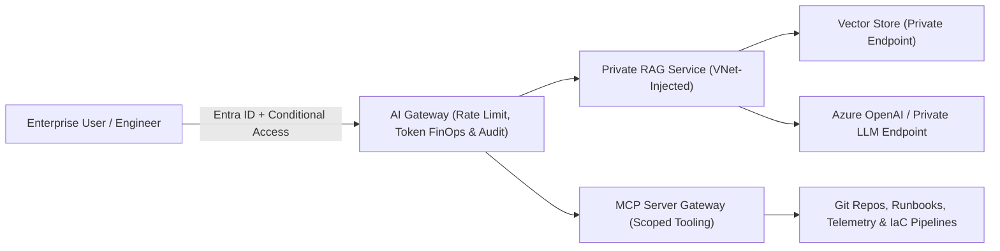

# 🎯 Enterprise Cloud, DevSecOps & AI Platform Architecture Guide

> **Author:** Sandip K Mishra  
> **Scope:** Enterprise Cloud Adoption Framework (CAF), Hub-and-Spoke Zero-Trust Networking, 100+ Workload Migration Strategy, Automated Terraform & DevSecOps Pipelines, Private AI (RAG & MCP) Platforms, FinOps, Resilience (HA/DR), Observability, and Vendor/Delivery Governance.

---

## Table of Contents

1. [Strategic Portfolio & Engineering Positioning](#1-strategic-portfolio--engineering-positioning)
2. [IT Career Tracks & Leadership Matrix](#2-it-career-tracks--leadership-matrix)
3. [The Senior Mindset: Business & Architecture Alignment](#3-the-senior-mindset-business--architecture-alignment)
4. [100+ Application Migration Scenario & 10 Quality Pillars](#4-100-application-migration-scenario--10-quality-pillars)
5. [Enterprise Governance, Identity & Management Hierarchy (CAF)](#5-enterprise-governance-identity--management-hierarchy-caf)
6. [Enterprise Hub-and-Spoke Networking Architecture](#6-enterprise-hub-and-spoke-networking-architecture)
7. [Multi-Layered Defense-in-Depth Security](#7-multi-layered-defense-in-depth-security)
8. [Terraform Landing Zone Automation & Drift Governance](#8-terraform-landing-zone-automation--drift-governance)
9. [Azure Repos, Git Governance & DevSecOps Pipelines](#9-azure-repos-git-governance--devsecops-pipelines)
10. [End-to-End Cloud Migration Execution Strategy](#10-end-to-end-cloud-migration-execution-strategy)
11. [FinOps (Cloud Financial Management)](#11-finops-cloud-financial-management)
12. [Backup, Disaster Recovery & High Availability](#12-backup-disaster-recovery--high-availability)
13. [Enterprise Observability & Monitoring](#13-enterprise-observability--monitoring)
14. [Vendor Management, Pre-Sales & Delivery Governance](#14-vendor-management-pre-sales--delivery-governance)
15. [Enterprise AI Platform Engineering (Private RAG, MCP & AIOps)](#15-enterprise-ai-platform-engineering-private-rag-mcp--aiops)

---

## 1. Strategic Portfolio & Engineering Positioning

At senior, lead, and architect levels, engineering impact is measured by **business outcomes**, **risk reduction**, **system architecture**, and **delivery leadership** — not isolated tool syntax.

### Core Portfolio Standards
- **Measurable Outcomes:** Frame infrastructure work around resilience, security posture, deployment velocity, and cost governance (FinOps).
- **Reusable Artifacts:** Maintain modular Terraform blueprints, policy-as-code gates, and documented reference architectures.
- **Architectural Decision Records (ADRs):** Document *why* specific trade-offs (networking, identity, state, DR) were selected.

---

## 2. IT Career Tracks & Leadership Matrix

| Role | Core Focus & Responsibilities |
| :--- | :--- |
| **Sales** | Business development, lead generation, executive client relationships. |
| **Pre-Sales (Techno-Functional)** | RFI/RFP responses, technical demonstrations, solution estimations, POCs, commercial proposals. |
| **TAM (Technical Account Manager)** | Trusted technical advisor, governance reviews, operational escalations, account health. |
| **Enterprise Architect** | Holistic technology blueprint spanning infrastructure, security, data, AI, and application ecosystems. |
| **Technical Lead** | Hands-on leadership, sprint execution, IaC/code reviews, and architecture enforcement. |

---

## 3. The Senior Mindset: Business & Architecture Alignment

Every architectural decision starts by answering: **"What is the business objective, and what is the functional domain?"**

### Executive & Leadership Responsibilities
- **Leadership & Team Upskilling:** Structured knowledge transfer (KT) sessions, mentoring engineers, and leading senior interview panels.
- **Vendor & Service Management:** SOW negotiations, deliverable sign-offs, and SLA/RACI tracking.
- **Pre-Sales & Proposals:** Technical estimations, POC execution, and RFI/RFP architecture responses.
- **Delivery Governance:** Standard Operating Procedures (SOPs), blameless incident retrospectives, and architecture compliance reviews.

---

## 4. 100+ Application Migration Scenario & 10 Quality Pillars

> **Scenario:** Migrating 100+ enterprise workloads across `Dev`, `UAT`, and `Production` from an On-Premises Datacenter to Microsoft Azure.

| # | Pillar | Architectural Objective |
| :---: | :--- | :--- |
| 1 | **Scalable** | Horizontal/vertical elasticity (VMSS, AKS, PaaS autoscaling) for peak demand. |
| 2 | **Robust** | Fault-tolerant design that handles dependency degradation gracefully. |
| 3 | **Secure** | Zero-trust identity, private endpoints, micro-segmentation, encryption at rest/transit. |
| 4 | **Reliable** | Deterministic deployments, health probes, and automated recovery workflows. |
| 5 | **Portable** | Containerization, IaC parameterization, and minimal cloud lock-in where required. |
| 6 | **Governed** | Management group hierarchy, Azure Policy guardrails, and RBAC separation. |
| 7 | **Highly Available** | Multi-Availability Zone topologies removing single points of failure. |
| 8 | **Cost-Optimized** | Rightsizing, commitment discounts (RIs/Savings Plans), and automated non-prod schedules. |
| 9 | **Backed Up** | Immutable backups, geo-redundant storage (GRS), and tested restore runbooks. |
| 10 | **Compliant & Monitored** | Centralized telemetry, CIS/MCSB benchmarks, and actionable alerting. |

---

## 5. Enterprise Governance, Identity & Management Hierarchy (CAF)

### Microsoft Cloud Adoption Framework (CAF) Phases
1. **Strategy:** Business justification and measurable ROI.
2. **Plan:** Workload alignment, org structure, and skill readiness.
3. **Ready:** Landing zone preparation and identity foundation.
4. **Adopt:** Migration and application modernization waves.
5. **Govern:** Azure Policy, guardrails, and compliance benchmarks.
6. **Secure & Manage:** Continuous monitoring, patching, and threat protection.

### Tenant & Management Group Hierarchy

### Governance Best Practices
- **Subscription Boundaries:** Separate subscriptions by environment (`Dev`, `UAT`, `Prod`) and function (`Platform` vs. `Application`) to isolate blast radiuses and avoid noisy-neighbor limits.
- **Azure Policy & Initiatives:** Assign CIS Azure Benchmark and Microsoft Cloud Security Benchmark (MCSB) initiatives at the Management Group level with documented, time-bound exemptions.
- **RBAC & PIM:** Enforce group-based RBAC via Microsoft Entra ID and Privileged Identity Management (PIM) with Just-In-Time (JIT) access and multi-stage approvals.

---

## 6. Enterprise Hub-and-Spoke Networking Architecture

### Key Networking Controls
- **IPAM & Non-Overlapping CIDR:** Comprehensive audit of on-premises address spaces prior to VNet allocation.
- **Centralized Traffic Inspection:** User Defined Routes (UDRs) force `0.0.0.0/0` and east-west inter-spoke traffic through Azure Firewall / NVA.
- **Controlled Ingress & Egress:** Outbound egress inspected via firewall with TLS inspection; inbound HTTP/S terminated at Application Gateway / Azure Front Door with WAF.
- **Private PaaS Connectivity:** All PaaS services accessed strictly over Private Endpoints with centralized Private DNS Zones linked to the Hub.

---

## 7. Multi-Layered Defense-in-Depth Security

| Security Layer | Key Controls & Technologies |
| :--- | :--- |
| **Identity Level** | Microsoft Entra ID, Conditional Access, MFA, Privileged Identity Management (PIM), Managed Identities / Workload Identity Federation. |
| **Networking Level** | Hub-and-Spoke topology, micro-segmentation via NSGs/ASGs, Azure Firewall Premium, Private Endpoints, DDoS Protection Standard. |
| **Governance Level** | Azure Policy enforcement, CIS / ISO27001 compliance benchmarks, Microsoft Defender for Cloud Secure Score. |
| **Compute & Data Level** | Defender for Servers, automated vulnerability scanning, Disk Encryption with Customer-Managed Keys (CMK), automated OS patch baselines. |

---

## 8. Terraform Landing Zone Automation & Drift Governance

- **Remote State Management:** Stored in private Azure Storage Accounts with blob lease locking, encryption at rest, and least-privilege Managed Identity authentication.
- **Modularity:** Reusable, parameterized Terraform modules governed by strict semantic versioning.
- **Automated Drift Detection:** Scheduled nightly pipelines running `terraform plan -detailed-exitcode` to surface manual out-of-band console changes immediately.

---

## 9. Azure Repos, Git Governance & DevSecOps Pipelines

### Branching & Protection Policies
- **Trunk-Based Development:** Short-lived feature branches (`feature/*`, `fix/*`) merging into protected `main`.
- **Mandatory Controls:** Strict branch protection, minimum 2 senior PR reviewers, `CODEOWNERS` enforcement, and "No Delete" / "No Direct Push" policies.

### Standard YAML Pipeline Flow
1. **Validate & Test:** `terraform validate`, `tflint`, unit/contract tests.
2. **Security & Secrets:** GitLeaks, Checkov, Trivy vulnerability and misconfiguration scans.
3. **Build & Plan:** Generate immutable plan and SBOM artifacts.
4. **Approval Gate:** Manual peer and change-board gates for `UAT` and `Production`.
5. **Deploy & Apply:** Execute infrastructure/workload rollout with Managed Identities.
6. **Automated Rollback & Bootstrap:** Automated rollback workflows on health-check failure; Cloud-Init / VM custom data for baseline agent bootstrapping.

---

## 10. End-to-End Cloud Migration Execution Strategy

- **Pre-Migration:** Azure Migrate discovery reports, application dependency mapping, ExpressRoute/VPN bandwidth sizing, target Landing Zone readiness, and verified pre-cutover backups.
- **During Cutover:** DNS TTL reduction, database replication final sync, traffic rerouting, and automated smoke/sanity tests.
- **Post-Migration & Hypercare:** Telemetry verification, performance benchmarking, user acceptance sanity checks, and 2–4 weeks dedicated war-room support.

---

## 11. FinOps (Cloud Financial Management)

- **Waste Elimination:** Automated detection and cleanup of unattached managed disks, stale snapshots, unassociated public IPs, and idle compute.
- **Rightsizing:** Resize over-provisioned VMs and databases using 30-day CPU/Memory/IOPS percentile telemetry.
- **Commitment Discounts:** Strategic 1-year and 3-year Reserved Instances (RIs) and Savings Plans for steady-state baselines.
- **Automated Scheduling:** Scheduled start/stop automation for `Dev` and `UAT` environments outside working hours.
- **Log Ingestion Optimization:** Tune Azure Monitor tables and filter verbose diagnostic logs at source via Data Collection Rules (DCR).

---

## 12. Backup, Disaster Recovery & High Availability

- **Storage Redundancy:**
  - **LRS (Locally Redundant Storage):** 3 copies within a single datacenter.
  - **ZRS (Zone-Redundant Storage):** 3 synchronous copies across 3 Availability Zones.
  - **GRS (Geo-Redundant Storage):** Asynchronous replication to a secondary paired region.
- **High Availability Compute:** Virtual Machine Scale Sets (VMSS) and AKS node pools distributed across Availability Zones.
- **Recovery Objectives:**
  - **RTO (Recovery Time Objective):** Maximum acceptable downtime duration before restoration.
  - **RPO (Recovery Point Objective):** Maximum acceptable data loss window (e.g., 15 minutes of transactional data).
- **Region Strategy:** Active primary region with Azure Site Recovery (ASR) replicating workloads to a paired secondary region.

---

## 13. Enterprise Observability & Monitoring

- **Centralized Telemetry:** Dedicated Log Analytics Workspaces aligned to platform and landing zone governance.
- **Azure Monitor Agent (AMA):** Source-level filtering via Data Collection Rules (DCR) to balance visibility and ingestion cost.
- **Actionable Alerting:** Dynamic Action Groups routing critical alerts to Microsoft Teams, Slack, or PagerDuty with linked operational runbooks.

---

## 14. Vendor Management, Pre-Sales & Delivery Governance

- **SOW (Statement of Work):** Defines scope, deliverables, acceptance criteria, milestones, timelines, and liabilities.
- **Technical Evaluation Matrix:** Objective vendor scoring across architecture fit, security compliance, delivery track record, and TCO.
- **RACI Matrix:** Explicit **R**esponsible, **A**ccountable, **C**onsulted, and **I**nformed boundaries per deliverable.
- **Escalation Matrix & Transition:** Defined SLA breach escalation paths, formal runbook handovers, architecture walkthroughs, and shadowing prior to final sign-off.

---

## 15. Enterprise AI Platform Engineering (Private RAG, MCP & AIOps)

Modern enterprises require AI platforms that adhere to the exact same **zero-trust networking, identity, and FinOps rigor** as core production workloads.

- **Private Enterprise RAG:** Isolate embedding pipelines, vector databases, and LLM endpoints inside spoke VNets using Private Endpoints and Entra ID RBAC — preventing data leakage onto public endpoints.
- **Model Context Protocol (MCP) Governance:** Expose internal runbooks, Git repositories, and observability queries to engineering copilots through least-privilege, audited MCP servers.
- **AIOps & DevSecOps Augmentation:** Accelerate PR blast-radius summarization, alert correlation, and post-mortem retrieval while keeping deterministic policy gates (`Checkov`, `Trivy`, `terraform plan`) as the final enforcement authority.
- **AI FinOps:** Enforce token quotas, model routing tiers, and chargeback telemetry at the API Gateway layer.
